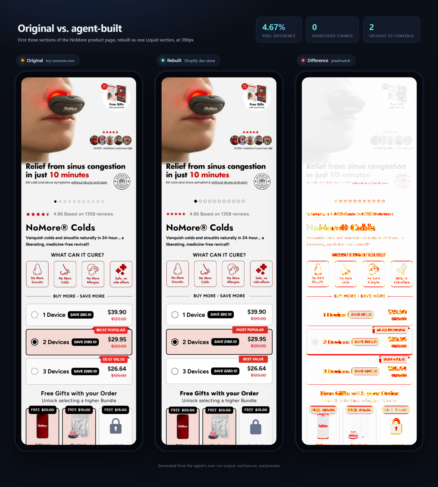
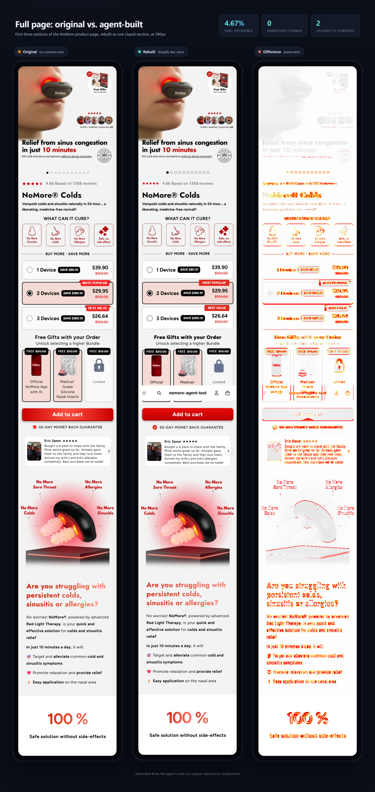
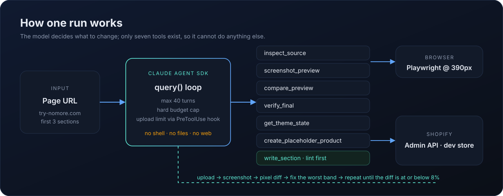

<div align="center">

# nomore-shopify-agent

**A Claude Agent SDK script that rebuilds a live landing page as one editable Shopify Liquid section, and checks its own work pixel by pixel.**




<sub>Left: the original page. Middle: the section the agent built in a Shopify dev store. Right: where the pixels differ. All at 390px, from a real run.</sub>

</div>

---

## At a glance

| | |
|---|---|
| **Input** | One product-page URL |
| **Output** | `sections/nomore-landing.liquid` plus a product template, uploaded to a Shopify theme |
| **Scope** | The first 3 sections: product hero with bundle cards, "Are you struggling…" block, 100% counter band |
| **Editable** | Every text and every image is a theme-editor setting. A linter rejects the upload otherwise |
| **Accuracy** | **4.67%** pixel difference from the original at 390px (target: 8% or less) |
| **Run** | 2 uploads, 13 turns, estimated cost about $2.36 |

The page is not copied. The agent reads the original at phone width, builds the section, renders it in a real store, and keeps fixing the biggest visual differences until the two match.

<details>
<summary><b>See the whole page, top to bottom</b></summary>
<br>

</details>

## How it works



The model can only act through seven tools. It has no shell, no file access and no web access.

| Tool | What it does |
|---|---|
| `inspect_source` | Loads the original at 390px: texts with computed styles, image URLs, cleaned HTML, a screenshot of each section |
| `get_theme_state` | Picks the theme and reports which files already exist |
| `create_placeholder_product` | Idempotent product upsert on a fixed handle, published to the Online Store |
| `write_section` | **Lints first**, then uploads the section and a template generated from its preset |
| `screenshot_preview` | Renders the store preview at 390px after images, reveals and counters settle |
| `compare_preview` | Pixel diff against the original, with per-band numbers and side-by-side strips |
| `verify_final` | Final checks, written to `out/report.json` |

### Design decisions

- **The linter is the "no hardcoded content" guarantee.** `write_section` rejects an upload, with exact reasons, if a visible string, alt text, label, image URL or CSS `url()` is not coming from a setting, if a referenced setting is missing from the schema, if `presets[0]` is absent, or if the Liquid is unbalanced.
- **Defaults live in `presets[0]`, and the template is generated from it.** JSON templates do not copy a preset's blocks on their own, so the script builds `product.nomore.json` itself. The theme editor opens with all default copy and images in place.
- **Images are `image_picker` settings with a URL fallback**, so the page renders immediately and each image can still be replaced in the editor.
- **The loop is bounded.** Max 40 turns, a hard `maxBudgetUsd`, and a `PreToolUse` hook that denies `write_section` after 6 uploads.
- **Safe to re-run.** The product is an upsert, never a duplicate. Theme pushes only touch two files and never delete anything.
- **Stale-screenshot guard.** A comparison is refused if the screenshot belongs to an older upload.
- **Two upload routes.** Shopify gates theme writes behind an exemption for some apps, so `THEME_WRITER=auto` tries the Admin API and falls back to `shopify theme push`.

## Quick start

You need Node 20.12 or newer, a Shopify dev store, and either an Anthropic API key or a signed-in Claude Code.

```powershell
git clone https://github.com/MicoleKurt/nomore-shopify-agent
cd nomore-shopify-agent
npm install
npx playwright install chromium
copy .env.example .env
npm run run
```

<details>
<summary><b>Shopify setup (about 5 minutes)</b></summary>
<br>

1. **Dev store.** Create one in your Partners or Dev Dashboard account, and set a storefront password under Online Store → Preferences. It goes in `SHOPIFY_STORE_PASSWORD`.
2. **App.** Since 1 January 2026 new apps are created in the [Dev Dashboard](https://dev.shopify.com/dashboard). Create an app with these scopes, release a version, and install it on the store:

   `read_themes, write_themes, read_products, write_products, read_publications, write_publications`

3. **Credentials.** Copy the app's Client ID and Client secret into `SHOPIFY_CLIENT_ID` and `SHOPIFY_CLIENT_SECRET`. The script swaps them for a 24-hour token at start-up. An older `shpat_` token in `SHOPIFY_ADMIN_TOKEN` also works.
4. **Only if theme uploads are refused:** install the free Theme Access app, create a password, and set `SHOPIFY_THEME_PASSWORD`. The script then uses the Shopify CLI automatically.

</details>

<details>
<summary><b>Authentication and cost</b></summary>
<br>

Set `ANTHROPIC_API_KEY` to bill an API account. If it is blank, the SDK uses the Claude Code login on the machine, and the cost the run prints is an estimate rather than a bill. `MAX_BUDGET_USD` (default 4) is a hard stop for the whole run, and the cost is written to `out/run-summary.json`.

</details>

### Commands

```
npm run run               full run, then a phone-size window for screen recording
npm run run -- --no-phone same, without the final window
npm run extract           capture the original only (no Shopify, no API key)
npm test                  71 tests
npm run typecheck
```

Output lands in `out/`: the final `nomore-landing.liquid`, every version, screenshots and comparison strips, `report.json` and `run-summary.json`.

## Example output

[`examples/nomore-landing.liquid`](examples/nomore-landing.liquid) is the section the agent produced in the run shown above, unedited.

## Tests

`npm test` covers the linter (every rule, positive and negative), the template generator, the image comparison, config validation, the Shopify client (retries, throttling, auth errors, idempotent product upsert, token exchange), both theme-upload routes and the fallback between them, and the agent tools. The model call and the live store need your keys, so they are not part of the tests.

## Known limits

- The pixel diff is a guide, not proof. Fonts, lazy images and animations can move a few percent.
- "First 3 sections" are picked by position on the page rendered at 390px, header and announcement bar excluded. If the source site changes layout, the pick changes with it.
- Behaviour is simplified, appearance is not: bundle cards look like the original and add the placeholder product, but the original's bundle logic and app integrations are not reproduced.

<div align="center"><sub>Built with the Claude Agent SDK, Playwright, pixelmatch and liquidjs.</sub></div>
